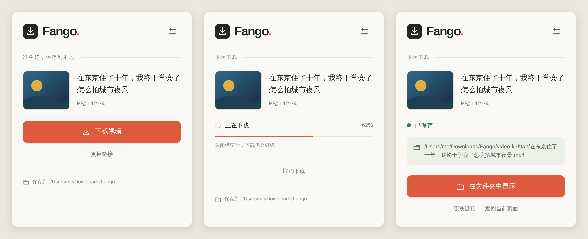

# Fetchy

[](LICENSE)


Save a single video from **YouTube, Bilibili, Xiaohongshu or Douyin** to a folder on your Mac.
One toolbar button, one command, or one function call. Everything runs locally.

[中文文档](README.zh-CN.md)

<p align="center">
  
</p>

## Features

- **Four platforms, one workflow.** Paste a link or open a video page, click once. Share text with a short link works too.
- **Local first.** Downloads run on your machine through a native host. No cloud service, no account, no cookie export.
- **Real, playable files.** Output is an MP4 validated with ffprobe for H.264 / yuv420p / AAC. Files are named after the actual video title and never overwrite existing files.
- **Keeps going.** Close the popup and the download continues; reopen it to see progress, cancel or reveal the file in Finder.
- **Same core everywhere.** The extension, the CLI and the Node API share one `resolveVideo` / `downloadVideo` contract with stable error codes.

## Supported platforms

| Platform    | Accepted input                                                       | Engine              | Notes                                                                              |
| ----------- | -------------------------------------------------------------------- | ------------------- | ---------------------------------------------------------------------------------- |
| YouTube     | `youtube.com/watch`, `youtu.be`, Shorts                              | yt-dlp              | Prefers native H.264/AAC, falls back to HLS on network errors                      |
| Bilibili    | `bilibili.com/video/BV…`, `av…`, multi-part `?p=`                    | yt-dlp              | DASH video and audio merged into MP4                                               |
| Xiaohongshu | Full share link with `xsec_token`, or share text containing one link | In-page (extension) | Media is read from the note page in your own browser; the CLI falls back to yt-dlp |
| Douyin      | `v.douyin.com` short links, `modal_id` links, detail pages           | In-page (extension) | Short links are expanded first; the CLI falls back to yt-dlp                       |

Single, finished videos only. Playlists, live streams, image notes, DRM content and watermark removal are out of scope.
See [docs/limitations.md](docs/limitations.md) for the full list.

## Requirements

| Tool                    | Needed for                                   | macOS install          |
| ----------------------- | -------------------------------------------- | ---------------------- |
| Node.js 22+             | everything                                   | `brew install node`    |
| FFmpeg + ffprobe        | merging, remuxing, validation                | `brew install ffmpeg`  |
| Python 3.10+            | running the pinned yt-dlp version            | `brew install python`  |
| yt-dlp (pinned version) | YouTube, Bilibili; every platform on the CLI | `npm run deps:install` |

Run `npm run doctor` at any time to see what is found and what is missing.

`npm run deps:install` installs the yt-dlp version in `requirements.txt` into
the project's `.venv`. This is an external downloader used by the Node core;
`npm install` alone does not install it. The same command works on macOS,
Linux and Windows and can be rerun to apply dependency updates. To select a
Python interpreter, use `npm run deps:install -- --python /path/to/python3`.
Install Node, Python and FFmpeg separately using your system package manager.

The native host installer currently supports **macOS** only. The download core and CLI also run on Linux and Windows.

## Quick start

```sh
git clone https://github.com/0xFANGO/fetchy.git
cd fetchy
npm install
npm run deps:install
npm run doctor

# download a video into ./downloads
node bin/fetchy.mjs download 'https://www.bilibili.com/video/BV19Pnb6REhD/'
```

The CLI prints a JSON result with the absolute file path, size and validation details. Progress goes to stderr. `Ctrl+C` cancels cleanly and leaves no half-written file behind.

## Browser extension

Every [release](https://github.com/0xFANGO/fetchy/releases) ships a ready-to-load `fetchy-extension-<version>.zip`. Download it, unzip it, and skip the build step below. The native host still comes from this repository, so clone it either way.

```sh
npm run extension:build                 # writes dist/extension (skip if you downloaded the release zip)
npm run native:install -- --browser chrome # registers the native host (--browser ego for Ego Lite)
```

1. Open `chrome://extensions/`, enable Developer mode, click **Load unpacked** and pick `dist/extension` (or the unzipped `extension` folder from the release).
2. Pin the extension to the toolbar.
3. Open a video page and click the icon, or paste a link into the popup.

Downloads go to `~/Downloads/Fetchy` by default; change it from the popup's settings view.

For Xiaohongshu and Douyin the extension reads the video's playback data from the page itself: an open tab on that video is used directly, otherwise a background tab is opened and closed again. Your logged-in session is used in place, nothing is exported. Permissions requested: `activeTab`, `storage`, `nativeMessaging`, `scripting`, plus host access to `xiaohongshu.com` and `douyin.com`.

Verified so far on macOS with Ego Lite (a Chromium browser). Chrome registration is available but not yet verified end to end.
Full installation notes, session requirements and troubleshooting: [docs/extension-install.md](docs/extension-install.md).

## CLI

```sh
node bin/fetchy.mjs resolve  <url>   # inspect formats without downloading
node bin/fetchy.mjs download <url>   # download
```

| Option                  | Default       | Description                                                                                     |
| ----------------------- | ------------- | ----------------------------------------------------------------------------------------------- |
| `--output <dir>`        | `./downloads` | Target directory; completed videos are saved directly here, with numbered names on collision    |
| `--engine auto\|yt-dlp` | `auto`        | The CLI uses yt-dlp for every platform; the browser engine is only reachable from the extension |
| `--max-height <px>`     | unlimited     | Upper bound on the actual frame height (a 1080×1920 portrait video is 1920)                     |
| `--transport auto\|hls` | `auto`        | Force HLS on YouTube                                                                            |
| `--timeout-ms <ms>`     | 30 min        | Whole-task timeout                                                                              |
| `--cookies-file <file>` | none          | Netscape cookie file for the yt-dlp engine; a private temporary copy is used                    |

`npm run download -- <url>` and `npm run resolve -- <url>` are shortcuts for the same commands.

## Node API

```js
import {resolveVideo, downloadVideo} from './src/index.mjs';

const url = 'https://www.bilibili.com/video/BV19Pnb6REhD/';

const info = await resolveVideo(url);
console.log(info.title, info.durationSeconds, info.formats.length);

const result = await downloadVideo(url, {
	outputDir: './downloads',
	maxHeight: 1080,
	onProgress: ({stage}) => console.log(stage),
});
console.log(result.filepath, result.validation);
```

Options: `outputDir`, `engine`, `maxHeight`, `transport`, `timeoutMs`, `signal` (an `AbortSignal`), `onProgress`, `cookiesFile`, plus tool paths `ytDlpPath`, `ffmpegLocation`, `ffprobePath`. `pageMedia` carries the output of `extractPageMedia` from a Xiaohongshu or Douyin page and switches those platforms to the browser engine; the extension fills it in automatically.

`resolveVideo` returns displayable metadata (`platform`, `id`, `title`, `thumbnailUrl`, `durationSeconds`, `formats`) and never exposes signed media URLs.
`downloadVideo` re-resolves the link, downloads, validates and returns `{filepath, bytes, validation, conversion, …}`.
Failures throw an `EngineError` with a stable `code` such as `invalid_url`, `unsupported_platform`, `network_error`, `auth_required`, `verification_required`, `drm`, `no_formats`, `dependency_missing`, `timeout` or `cancelled`.

## How it works

```
extension/   Manifest V3 popup + service worker   ─┐
bin/         CLI                                   ├─▶ src/index.mjs ─▶ yt-dlp engine (yt-dlp + FFmpeg)
native/      Native Messaging host + daemon       ─┘                  └─▶ browser engine (media read from the page by the extension)
```

For Xiaohongshu and Douyin the service worker injects `src/page-extract.mjs` into the video page, which returns only the target video's title, cover and signed media URLs; the native host downloads from those URLs and validates the file. The popup is only a view. A native host hands each task to a standalone daemon that owns the download, so closing the popup, rebuilding the service worker or dropping the port never cancels a transfer. Persisted task records contain no raw inputs, tokens or signed URLs.

## Development

```sh
npm test              # offline contract tests (FFmpeg required for the MP4 suite)
npm run check         # oxfmt --check + oxlint
npm run fmt           # format
```

See [CONTRIBUTING.md](CONTRIBUTING.md). Design notes, platform research and manual validation logs live in [docs/](docs/).

## License

[AGPL-3.0](LICENSE). You can use, modify and share Fetchy freely; if you distribute a modified version or run one as a service, you must publish your source under the same license.

This tool is for saving content you are allowed to keep, for personal use. Respect each platform's terms of service and the rights of content creators. The license covers the code only, not any downloaded content.
