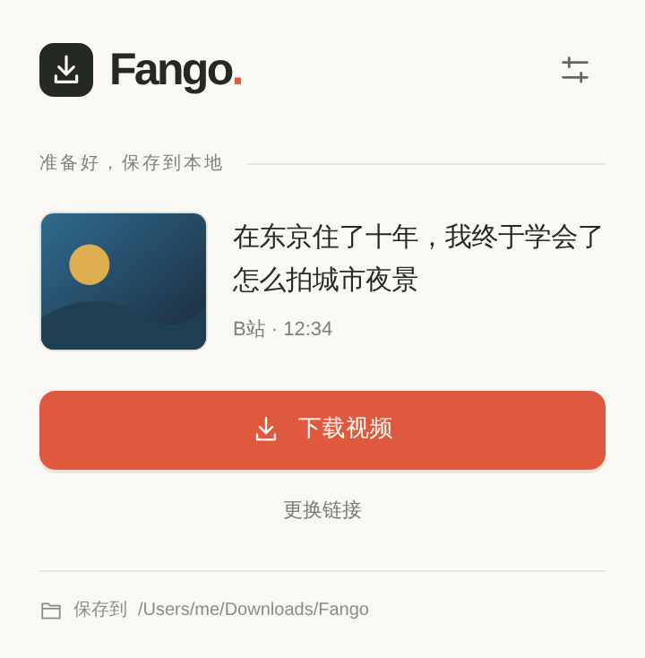
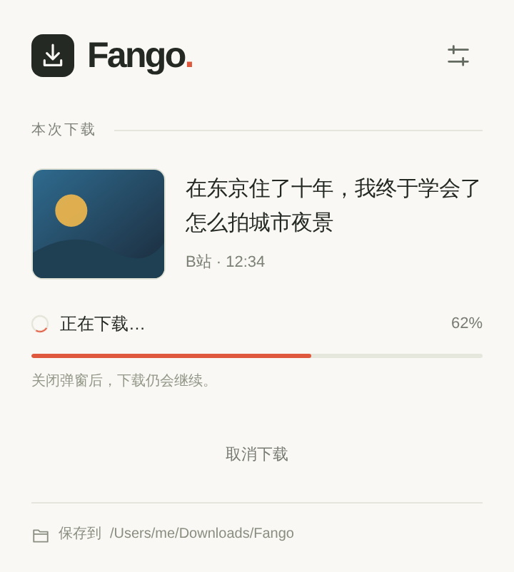
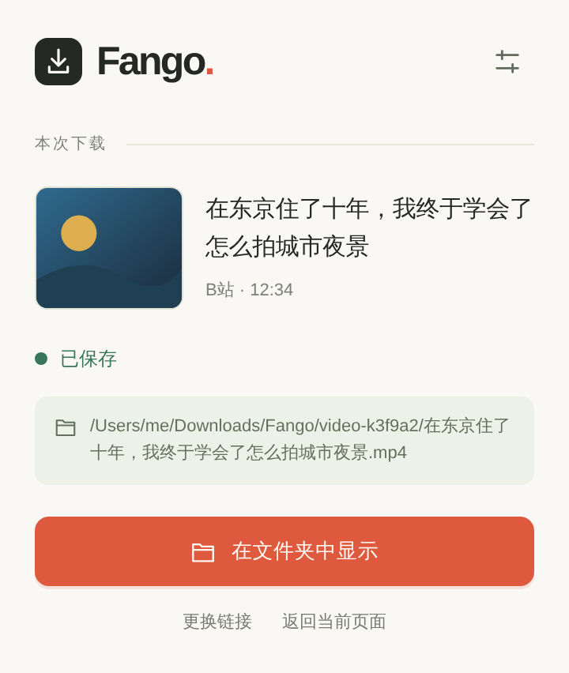

# Fango Video Downloader

[](https://github.com/0xFANGO/fango-video-downloader/actions/workflows/ci.yml)
[](LICENSE)
[](package.json)
[](docs/extension-install.md)

把 **YouTube、B站、小红书、抖音** 的单个视频保存到你 Mac 上的文件夹。
一个工具栏按钮、一条命令或一个函数调用，全部在本机完成。

[English](README.md)

<p align="center">
  
  
  
</p>

## 特性

- **四个平台，同一套流程。** 打开视频页点一下，或粘贴链接、粘贴带短链的分享文案。
- **本地优先。** 下载由本机 native host 执行，没有云端服务，不需要账号，不导出 Cookie。
- **真正能播的文件。** 输出 MP4 并用 ffprobe 校验 H.264 / yuv420p / AAC；文件名使用真实视频标题，重名自动加序号，不覆盖已有文件。
- **关掉弹窗也继续。** 下载由独立本地进程持有，重新打开弹窗即可查看进度、取消或在 Finder 中定位文件。
- **一套核心。** 扩展、CLI 和 Node API 共用同一个 `resolveVideo` / `downloadVideo` 契约和稳定的错误码。

## 支持的平台

| 平台    | 接受的输入                                             | 引擎             | 说明                                              |
| ------- | ------------------------------------------------------ | ---------------- | ------------------------------------------------- |
| YouTube | `youtube.com/watch`、`youtu.be`、Shorts                | yt-dlp           | 优先原生 H.264/AAC，网络错误时有限尝试 HLS        |
| B站     | `bilibili.com/video/BV…`、`av…`、分 P `?p=`            | yt-dlp           | DASH 音视频合并为 MP4                             |
| 小红书  | 含 `xsec_token` 的完整分享链接，或含单个链接的分享文案 | 页面读取（扩展） | 直接从你浏览器里的笔记页读取媒体；CLI 退回 yt-dlp |
| 抖音    | `v.douyin.com` 短链、`modal_id` 链接、详情页           | 页面读取（扩展） | 先展开短链；CLI 退回 yt-dlp                       |

只处理单个已完成的视频。合集、直播、图文笔记、DRM 内容和去水印不在范围内，完整说明见 [docs/limitations.md](docs/limitations.md)。

## 环境要求

| 工具               | 用途                           | macOS 安装                                                                     |
| ------------------ | ------------------------------ | ------------------------------------------------------------------------------ |
| Node.js 22+        | 全部                           | `brew install node`                                                            |
| FFmpeg + ffprobe   | 合并、重封装、校验             | `brew install ffmpeg`                                                          |
| yt-dlp（固定版本） | YouTube、B站；命令行下所有平台 | `python3 -m venv .venv && .venv/bin/python -m pip install -r requirements.txt` |

随时运行 `npm run doctor` 查看哪些工具已找到、哪些缺失。

native host 安装脚本目前只支持 **macOS**。下载核心和 CLI 也能在 Linux 和 Windows 上运行。

## 快速开始

```sh
git clone https://github.com/0xFANGO/fango-video-downloader.git
cd fango-video-downloader
npm install
python3 -m venv .venv && .venv/bin/python -m pip install -r requirements.txt
npm run doctor

# 下载到 ./downloads
node bin/fango-download.mjs download 'https://www.bilibili.com/video/BV19Pnb6REhD/'
```

CLI 以 JSON 输出结果，包含文件绝对路径、大小和校验信息；阶段信息写入 stderr。`Ctrl+C` 可干净地取消，不会留下半截文件。

## 浏览器扩展

```sh
npm run extension:build                 # 输出到 dist/extension
npm run native:install -- --browser chrome # 注册 native host；Ego Lite 用 --browser ego
```

1. 打开 `chrome://extensions/`，开启开发者模式，点击「加载已解压的扩展程序」，选择 `dist/extension`。
2. 把扩展固定到工具栏。
3. 打开视频页点击图标，或在弹窗里粘贴链接。

默认保存到 `~/Downloads/Fango`，可在弹窗的设置页修改。

小红书和抖音的媒体信息由扩展直接从视频页面读取：已经打开的视频页会被直接使用，否则扩展在后台打开一个标签页，读完就关闭。用的是你当前浏览器的登录态，不导出任何东西。申请的权限：`activeTab`、`storage`、`nativeMessaging`、`scripting`，以及 `xiaohongshu.com` 和 `douyin.com` 的站点访问权限。

目前在 macOS + Ego Lite（一款 Chromium 浏览器）上完成了真实验证；Chrome 的注册选项可用，但尚未端到端验证。
完整安装说明、登录态要求和故障排查见 [docs/extension-install.md](docs/extension-install.md)。

## 命令行

```sh
node bin/fango-download.mjs resolve  <url>   # 只解析规格，不下载
node bin/fango-download.mjs download <url>   # 下载
```

| 选项                    | 默认值        | 说明                                                        |
| ----------------------- | ------------- | ----------------------------------------------------------- |
| `--output <目录>`       | `./downloads` | 输出目录，每次下载在其中创建独立的 `video-*` 子目录         |
| `--engine auto\|yt-dlp` | `auto`        | 命令行全部平台使用 yt-dlp；浏览器引擎只能由扩展触发         |
| `--max-height <像素>`   | 不限          | 实际帧高度上限（1080×1920 竖屏的高度是 1920）               |
| `--transport auto\|hls` | `auto`        | YouTube 强制使用 HLS                                        |
| `--timeout-ms <毫秒>`   | 30 分钟       | 整个任务的超时                                              |
| `--cookies-file <文件>` | 无            | 仅 yt-dlp 引擎使用的 Netscape Cookie 文件，使用临时私有副本 |

`npm run download -- <url>` 和 `npm run resolve -- <url>` 是同样命令的快捷方式。

## Node API

```js
import {resolveVideo, downloadVideo} from './src/index.mjs';

const url = 'https://www.bilibili.com/video/BV19Pnb6REhD/';

const info = await resolveVideo(url);
console.log(info.title, info.durationSeconds, info.formats.length);

const result = await downloadVideo(url, {
	outputDir: './downloads',
	maxHeight: 1080,
	onProgress: ({stage}) => console.log(stage),
});
console.log(result.filepath, result.validation);
```

选项：`outputDir`、`engine`、`maxHeight`、`transport`、`timeoutMs`、`signal`（`AbortSignal`）、`onProgress`、`cookiesFile`，以及工具路径 `ytDlpPath`、`ffmpegLocation`、`ffprobePath`。`pageMedia` 用于传入 `extractPageMedia` 从小红书或抖音页面读到的结果，传入后这两个平台会走浏览器引擎；扩展会自动填入。

`resolveVideo` 返回可展示的元数据（`platform`、`id`、`title`、`thumbnailUrl`、`durationSeconds`、`formats`），不暴露签名媒体 URL。
`downloadVideo` 重新解析链接、下载、校验，返回 `{filepath, bytes, validation, conversion, …}`。
失败抛出带稳定 `code` 的 `EngineError`，例如 `invalid_url`、`unsupported_platform`、`network_error`、`auth_required`、`verification_required`、`drm`、`no_formats`、`dependency_missing`、`timeout`、`cancelled`。

## 工作原理

```
extension/   Manifest V3 弹窗 + service worker  ─┐
bin/         CLI                                 ├─▶ src/index.mjs ─▶ yt-dlp 引擎（yt-dlp + FFmpeg）
native/      Native Messaging host + daemon     ─┘                  └─▶ 浏览器引擎（扩展从页面读取媒体）
```

小红书和抖音由 service worker 把 `src/page-extract.mjs` 注入视频页，只取回目标视频的标题、封面和带签名的媒体地址；native host 从这些地址下载并校验文件。弹窗只是视图。native host 把每个任务交给独立的 daemon 进程执行，所以关闭弹窗、service worker 重建或端口断开都不会取消传输。持久化的任务记录不含原始输入、token 或签名 URL。

## 开发

```sh
npm test              # 离线契约测试；MP4 相关用例需要 FFmpeg
npm run check         # oxfmt --check + oxlint
npm run fmt           # 格式化
```

参与方式见 [CONTRIBUTING.md](CONTRIBUTING.md)。设计文档、平台调研和真实验证记录在 [docs/](docs/)。

## 许可证

本项目以 [PolyForm Noncommercial License 1.0.0](LICENSE) 公开源码。允许个人、教育、研究等非商业用途，包括修改和分发副本，分发时须附带许可条款和 [NOTICE](NOTICE) 中的 `Required Notice`。不授予商业用途。它不是 [OSI 定义](https://opensource.org/osd)的开源许可证，对外介绍时请使用"免费、源码公开、非商用"的说法。常见问题见 [docs/license-faq.md](docs/license-faq.md)。

本工具用于保存你有权保留的内容，仅限个人使用。请遵守各平台的服务条款，尊重内容创作者的权利。许可证只覆盖代码，不覆盖任何下载下来的内容。
