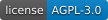

# Fetchy

[](LICENSE)


用 CLI、浏览器扩展或 macOS 桌面端把视频、音频和可离线阅读的帖子存进本地资料库。

[English](README.md)

## 演示

https://github.com/user-attachments/assets/e5ebb617-7dd1-4369-b044-b7e8900cb662

## 特性

- **从视频页或链接开始。** 在视频页打开扩展，或粘贴一条视频链接。支持短链的平台也可以粘贴含单条链接的分享文案。
- **下载在本机执行。** 扩展把下载交给本地组件，无需注册 Fetchy 账号。
- **经过校验的 MP4。** 每个输出都经 ffprobe 校验。yt-dlp 下载输出 H.264 / yuv420p 视频，有音轨时使用 AAC。浏览器引擎保留源编码，包括 HEVC。文件名使用视频标题，重名自动加序号，不覆盖已有文件。
- **关掉弹窗也继续。** 下载由独立本地进程持有，重新打开弹窗即可查看进度、取消或在 Finder 中定位文件。
- **一套核心。** 扩展、CLI 和 Node API 共用同一个 `resolveVideo` / `downloadVideo` 契约和稳定的错误码。

## 支持的平台

| 平台         | 接受的输入                                                                      | 引擎             | 说明                                                     |
| ------------ | ------------------------------------------------------------------------------- | ---------------- | -------------------------------------------------------- |
| YouTube      | `youtube.com/watch`、`youtu.be`、Shorts                                         | yt-dlp           | 优先原生 H.264/AAC，网络错误时有限尝试 HLS               |
| B站          | `bilibili.com/video/BV…`、`av…`、分 P `?p=`                                     | yt-dlp           | DASH 音视频合并为 MP4                                    |
| 小红书       | 含 `xsec_token` 的完整分享链接，或含单个链接的分享文案                          | 页面读取（扩展） | 直接从你浏览器里的笔记页读取媒体；CLI 退回 yt-dlp        |
| 抖音         | `v.douyin.com` 短链、`modal_id` 链接、详情页                                    | 页面读取（扩展） | 先展开短链；CLI 退回 yt-dlp                              |
| X（Twitter） | `x.com/<用户名>/status/<帖子 ID>`，也支持 `twitter.com` 和 `/i/web/status/<ID>` | yt-dlp           | 含单个可提取视频的公开帖子                               |
| Instagram    | `instagram.com/reel/<作品短码>/`                                                | yt-dlp           | 单个公开 Reel，含作者主页下的详情链接和 `/reels/<短码>/` |

另有 Facebook、TikTok、Bluesky、Reddit、Pinterest、微博、视频托管和音乐站点的单链适配。各站已验证的成品、图文和收藏历史范围见[完整平台表](docs/platforms.md)。

## 桌面端和本地资料库

在 macOS 14 及以上运行 `npm run desktop:build` 即可构建可双击的 Fetchy.app。桌面端支持粘贴链接、选择目录、查看共享任务，并按平台、原收藏夹或主题检索。资料库需要 Node 22.13 或更高版本。[桌面端设置](docs/desktop.md) · [收藏清单与命令](docs/library.md)

```sh
node bin/fetchy.mjs info '<链接>'
node bin/fetchy.mjs get '<链接>' --output ./downloads
node bin/fetchy.mjs batch -i links.txt
node bin/fetchy.mjs browse '<链接>'
node bin/fetchy.mjs library tasks
```

`get` 输出包含任务 ID 和本地路径的 JSON。批量输入支持每行一个链接或 JSON 数组，逐条输出结果，遇到部分保存或失败时整体返回非零。用当前浏览器的登录状态保存图文或收藏夹，可从原帖或列表页打开扩展。离线页面保留可读正文、附件顺序及缺失项。[通用网页与验证](docs/web-media.md)

## 环境要求

| 工具               | 用途                              | macOS 安装             |
| ------------------ | --------------------------------- | ---------------------- |
| Node.js 22+        | 全部                              | `brew install node`    |
| FFmpeg + ffprobe   | 合并、重封装、校验                | `brew install ffmpeg`  |
| Python 3.10+       | 运行固定版本的 yt-dlp             | `brew install python`  |
| yt-dlp（固定版本） | 所有 CLI 下载及扩展的 yt-dlp 下载 | `npm run deps:install` |

随时运行 `npm run doctor` 查看哪些工具已找到、哪些缺失。

`npm run deps:install` 将 `requirements.txt` 中固定版本的 yt-dlp 安装到项目的 `.venv`。
它是 Node 核心调用的外部下载器，单独执行 `npm install` 不会安装它。此命令适用于
macOS、Linux 和 Windows，也可以重复执行以应用依赖更新。需要指定 Python 时，使用
`npm run deps:install -- --python /path/to/python3`。Node、Python 和 FFmpeg 仍由系统包管理器安装。

native host 安装脚本目前只支持 **macOS**。下载核心和 CLI 也能在 Linux 和 Windows 上运行。

## 快速开始

```sh
git clone https://github.com/0xFANGO/fetchy.git
cd fetchy
npm install
npm run deps:install
npm run doctor

# 下载到 ./downloads
node bin/fetchy.mjs download 'https://www.bilibili.com/video/BV19Pnb6REhD/'
```

CLI 以 JSON 输出结果，包含文件绝对路径、大小和校验信息；阶段信息写入 stderr。`Ctrl+C` 可干净地取消，不会留下半截文件。

## 浏览器扩展

要在扩展中保存 X 视频或 Instagram Reel，请在包含这些适配的源码目录执行下面两条命令，再加载构建出的扩展。已发布的 v0.3.1 ZIP 支持 YouTube、B站、小红书和抖音。使用该版本时，解压 ZIP 即可跳过构建，本地组件仍需从对应源码安装。[v0.3.1 下载](https://github.com/0xFANGO/fetchy/releases/tag/v0.3.1)

```sh
npm run extension:build                 # 构建当前源码，输出到 dist/extension
npm run native:install -- --browser chrome # 注册 native host；Ego Lite 用 --browser ego
```

1. 打开 `chrome://extensions/`，开启开发者模式，点击「加载已解压的扩展程序」，选择 `dist/extension`（或 Release 解压出来的 `extension` 文件夹）。
2. 把扩展固定到工具栏。
3. 打开视频页点击图标，或在弹窗里粘贴链接。

默认保存到 `~/Downloads/Fetchy`。点击弹窗底部的目录即可更改，选中后自动保存。显示任务期间不可更改目录。

小红书和抖音的媒体信息由扩展直接从视频页面读取：已经打开的视频页会被直接使用，否则扩展在后台打开一个标签页，读完就关闭。用的是你当前浏览器的登录态，不导出任何东西。申请的权限：`activeTab`、`storage`、`nativeMessaging`、`scripting`，以及 `xiaohongshu.com`、`douyin.com` 和 `iesdouyin.com` 的站点访问权限。

各浏览器和站点的实测结果见[扩展验证记录](docs/extension-validation.md)。注册本地组件、登录及故障排查见[安装说明](docs/extension-install.md)。

## 原有视频命令

```sh
node bin/fetchy.mjs resolve  <url>   # 只解析规格，不下载
node bin/fetchy.mjs download <url>   # 下载
```

| 选项                    | 默认值        | 说明                                                        |
| ----------------------- | ------------- | ----------------------------------------------------------- |
| `--output <目录>`       | `./downloads` | 成片直接保存到此目录，同名文件自动加序号                    |
| `--engine auto\|yt-dlp` | `auto`        | 命令行全部平台使用 yt-dlp；浏览器引擎只能由扩展触发         |
| `--max-height <像素>`   | 不限          | 实际帧高度上限（1080×1920 竖屏的高度是 1920）               |
| `--transport auto\|hls` | `auto`        | YouTube 强制使用 HLS                                        |
| `--timeout-ms <毫秒>`   | 30 分钟       | 整个任务的超时                                              |
| `--cookies-file <文件>` | 无            | 仅 yt-dlp 引擎使用的 Netscape Cookie 文件，使用临时私有副本 |

`npm run download -- <url>` 和 `npm run resolve -- <url>` 是同样命令的快捷方式。

## Node API

```js
import {resolveVideo, downloadVideo} from './src/index.mjs';

const url = 'https://www.bilibili.com/video/BV19Pnb6REhD/';

const info = await resolveVideo(url);
console.log(info.title, info.durationSeconds, info.formats.length);

const result = await downloadVideo(url, {
	outputDir: './downloads',
	maxHeight: 1080,
	onProgress: ({stage}) => console.log(stage),
});
console.log(result.filepath, result.validation);
```

选项：`outputDir`、`engine`、`maxHeight`、`transport`、`timeoutMs`、`signal`（`AbortSignal`）、`onProgress`、`cookiesFile`，以及工具路径 `ytDlpPath`、`ffmpegLocation`、`ffprobePath`。`pageMedia` 用于传入 `extractPageMedia` 从小红书或抖音页面读到的结果，传入后这两个平台会走浏览器引擎；扩展会自动填入。

`resolveVideo` 返回可展示的元数据（`platform`、`id`、`title`、`thumbnailUrl`、`durationSeconds`、`formats`），不暴露签名媒体 URL。
`downloadVideo` 重新解析链接、下载、校验，返回 `{filepath, bytes, validation, conversion, …}`。
失败抛出带稳定 `code` 的 `EngineError`，例如 `invalid_url`、`unsupported_platform`、`network_error`、`auth_required`、`verification_required`、`drm`、`no_formats`、`dependency_missing`、`timeout`、`cancelled`。

## 工作原理

```
extension/   Manifest V3 弹窗 + service worker  ─┐
bin/         CLI                                 ├─▶ src/index.mjs ─▶ yt-dlp 引擎（yt-dlp + FFmpeg）
native/      Native Messaging host + daemon     ─┘                  └─▶ 浏览器引擎（扩展从页面读取媒体）
```

小红书和抖音由 service worker 把 `src/page-extract.mjs` 注入视频页，只取回目标视频的标题、封面和带签名的媒体地址；native host 从这些地址下载并校验文件。弹窗只是视图。native host 把每个任务交给独立的 daemon 进程执行，所以关闭弹窗、service worker 重建或端口断开都不会取消传输。持久化的任务记录不含原始输入、token 或签名 URL。

## 开发

```sh
npm test              # 离线契约测试；MP4 相关用例需要 FFmpeg
npm run check         # oxfmt --check + oxlint
npm run fmt           # 格式化
```

参与方式见 [CONTRIBUTING.md](CONTRIBUTING.md)。设计文档、平台调研和真实验证记录在 [docs/](docs/)。

## 许可证

[AGPL-3.0](LICENSE)。可以自由使用、修改和分享；分发修改版或以服务形式提供时，必须以相同许可证公开源码。

本工具用于保存你有权保留的内容，仅限个人使用。请遵守各平台的服务条款，尊重内容创作者的权利。许可证只覆盖代码，不覆盖任何下载下来的内容。

平台名称和标志归各自所有者所有，Fetchy 与这些平台无关联，也未获其认可。图标来自 [Simple Icons](https://simpleicons.org)（CC0）。
