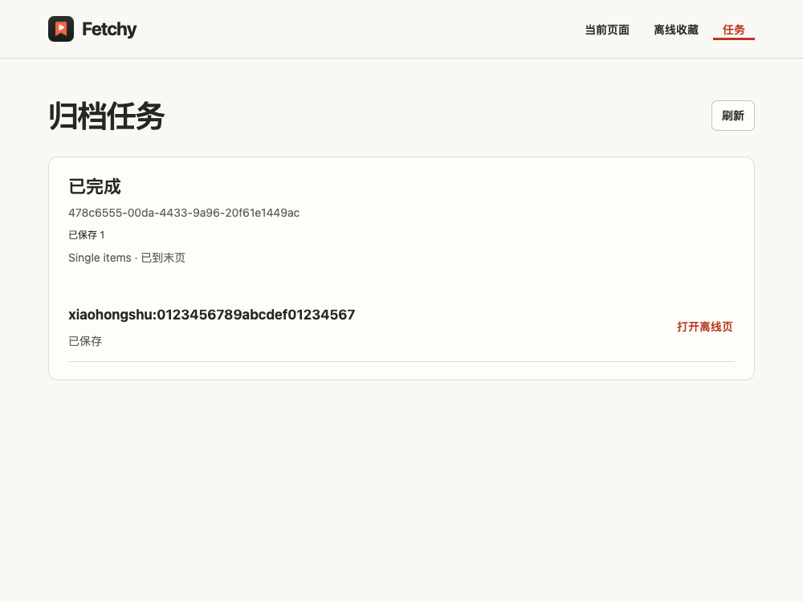

# Archive from the browser

Open an original post, article or collection you may save and click the Fetchy toolbar button. Fetchy opens in Chrome's side panel beside that page and follows the tab you are looking at. It never opens tabs of its own to read pages.

- **On a post** the panel shows the title, author, whether the text is complete and the number of images and videos. **保存这篇帖子** saves the post with its files; **只下载视频** saves the video file alone. Expand shortened text on the page first if the panel reports an incomplete body.
- **On a collection** the panel shows how many entries it has read and the total the site displays. **再读一屏** scrolls your tab by one screen or loads the site's next page in place; **自动读到底** keeps going from the top until the end and can be stopped. When you scroll the page yourself, the list grows too. Everything read is ticked; untick what to leave out and click **保存所选**.
- **On a folder directory** the panel lists the folders; choosing one opens it in the same tab.
- **页面上播放过的媒体** lists visible media and resource entries already loaded in the tab. **下载** hands one to the local component. Expired, restricted and encrypted resources can fail.

**保存所选** hands the list to the local component, which creates the task before any post is read. For each selected entry that arrived without text or files, the extension's background worker then reads its post page with a same-origin request from your tab and passes the page's state scripts and meta tags to the local component. Entries the list already filled, such as X bookmarks, keep what the list provided. The local component parses the pages, downloads every image and video itself and records each entry as saved, partial or failed with a reason. An entry whose post page cannot be read keeps its title and link and is marked partial with the reason. Closing the panel or the browser does not stop the task. When the tab is gone, the local component reads the remaining posts itself with the site's sign-in from the desktop app.

The panel shows the task's progress. Failed and partial entries list their reason with a **重试** button; **重试失败项** retries all of them. A task interrupted by quitting the local component resumes from its unfinished entries the next time it starts. The desktop app and CLI use the same library and task IDs. See the [library commands and import format](library.md).

If the panel asks you to update the local component, install the matching Fetchy checkout and rebuild the extension. Finish any active downloads, disable the extension in each browser using it, and allow the idle worker to exit (about five minutes). Re-enable the updated extension.

## What the extension can read

| Page                    | Scope and coverage                                                                                                                                                                                                                                                                                      |
| ----------------------- | ------------------------------------------------------------------------------------------------------------------------------------------------------------------------------------------------------------------------------------------------------------------------------------------------------- |
| Xiaohongshu             | A note's matching ID selects its original text and ordered image list or video source. Open a named album to read its notes. On a profile, switch to **收藏 → 专辑** for named albums, or **收藏 → 笔记** for the saved-note list. The latter reads the active panel and checks its own reported count. |
| X                       | A status permalink selects the matching post among replies. Text, an expanded article and identifiable media keep their order within the body and attachment list. Open **Bookmarks** or a visible named bookmark folder to read its visible entries. An unconfirmed end remains partial.               |
| Bilibili                | An open space favorites page uses the site's favorites listing in that tab's current session. Individual folders expose page numbers and reported totals. Items selected for video download use Fetchy's video engine.                                                                                  |
| YouTube                 | A playlist exposes the entries present as you scroll, including a reported total when displayed. The playlist directory exposes visible playlists. Video availability is checked when saving.                                                                                                           |
| Zhihu and article pages | A Zhihu collection provides links to original questions' answers or columns. An individual article can preserve headings, text and ordinary links. Access restrictions, folded text and missing media may leave a partial entry.                                                                        |

For Instagram Saved, Douyin favorites, Threads Saved and TikTok Favorites, open the collection or select its tab before reading. Each reader checks the active list and the source item links. [Supported collection pages](collections.md)

Reading uses the tab you are looking at. The panel may ask for access to a site before reading it. Browser session credentials stay with the site: post pages are read with the site's own session inside your tab, and the local component receives the page's data, never the cookies. Media files are downloaded by the local component with the post's site as Referer, with no combined size limit for a batch. A file that fails keeps its position in the post and records why. Xiaohongshu notes and Zhihu answers and columns are parsed in full from their pages. Other sites fall back to the page's preview and stay partial; X bookmarks take each post's text and images from the timeline, and timeline videos are saved from the post link. Each site's route still needs checking against a signed-in account. Opening a login page, a preview or a collection with an unknown end cannot establish complete coverage.

## Browser regression

The run below predates the side panel: it used the earlier archive tab, which read posts in temporary tabs and sent images through the browser.

On November 18, 2026, Chrome for Testing 157 on macOS ran the unpacked extension with an isolated profile and native host. The test served locally authored pages and media over HTTPS. Each flow started at the browser's toolbar, submitted through the archive UI, then found the resulting persistent task and local HTML.

| Input                        | Offline check                                                                                                       |
| ---------------------------- | ------------------------------------------------------------------------------------------------------------------- |
| Three-image Xiaohongshu note | Three distinct images decoded in their original slots. The browser read the image responses with CORS.              |
| Text-only X post             | Full text and punctuation survived without a media attachment.                                                      |
| Long article and X article   | First, middle and final paragraphs, a section heading and a link survived.                                          |
| X post with mixed media      | The local page rendered image, video, image in order. Its video played with the browser offline.                    |
| Named album with two pages   | The UI deduplicated the repeated first note and displayed two of two. Selecting only the second archived that note. |

The same browser run also found a direct video, HLS playlist and DASH manifest that the fixture player had loaded. A save attempt for a loopback-only fixture reached the native component and received its public-network restriction.

A separate native import checked a two-page album with six 10,272,538-byte PNG fixtures. Inlining all six would have used 82,180,320 base64 characters. The browser transfer planner sent a 27,395,024-byte manifest to the native component, which kept all six works and their text in one task. Two images were stored inline. The remaining four kept their original slots and became partial when the local-only fixture URLs failed the public-network check.

A separate desktop and CLI check reopened the same Chrome-created three-image and text-only tasks. Both reported the same task IDs and one addition each. These fixture results exercise Fetchy's end-to-end behavior. Live site availability and account-specific coverage are recorded separately in the [platform matrix](platforms.md).

The default `npm test` includes offline capture, identity, album count, collection reading, post page parsing and native batch checks, and asserts that the extension opens no tab except the help page. `test/extension-library.chrome.mjs` still drives the earlier archive tab and must be rewritten for the side panel before it can run again. To repeat the earlier real-browser scenario on macOS, install the current native host in a fresh browser profile. Set `FETCHY_TEST_ROOT` to an isolated directory containing `dist/extension`, `chrome-profile/NativeMessagingHosts` and the local component's `native-state` directory. Set `FETCHY_TEST_CHROME` to a Chrome for Testing executable and `FETCHY_TEST_PLAYWRIGHT` to a Playwright Core ES module. Run `node test/extension-library.chrome.mjs` with FFmpeg and OpenSSL on PATH. The runner generates disposable media and a local TLS certificate.
