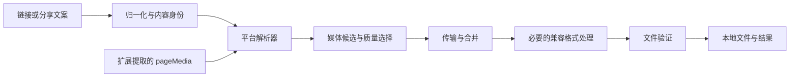

# 多平台视频下载核心契约

本文定义 Fetchy 下载核心（Node API 与 CLI）的平台身份、媒体解析、输出格式、错误分类和文件校验契约。扩展交互与验收规范见 [扩展界面与交互规范](extension-ui-requirements.md)，本地桥接协议见 [本地组件说明](../native/README.md)，面向用户的行为边界见 [实现边界](limitations.md)，历史与真实样例验证记录见 [核心验证记录](validation.md) 和 [扩展验证记录](extension-validation.md)。

需求来源：[fango-media #147：和 AI 做一个视频下载浏览器插件](https://github.com/0xFANGO/fango-media/issues/147)（私有仓库）。

## 1. 目标与范围

用户提供一个 YouTube、小红书、抖音或 B站视频链接，核心自动识别目标内容，选择可用媒体，保存并校验本地文件，返回可信结果或明确错误。调用方不需要了解各平台的接口、签名或音视频分离方式。

核心使用 Node.js 22+、yt-dlp 与 FFmpeg/ffprobe，提供统一的 Node API 与 CLI；小红书和抖音由扩展注入页面读取媒体后传入核心（`options.pageMedia`），CLI 及不带 `pageMedia` 的调用统一走 yt-dlp 匿名路径。“支持平台”不意味着该平台任意视频都可下载。

### 核心能力

- 单链接或含单个链接的分享文案输入；平台识别、归一化与内容身份校验。
- 分离 `resolve` 与 `download`，共用元数据、错误、进度和结果模型。
- 媒体获取、音视频合并、本地校验与失败清理。
- yt-dlp 下载路径默认交付 MP4 + H.264（yuv420p）+ AAC；优先原生兼容流，必要时自动重封装或转码并验证实际编码。
- 支持抖音分享短链跳转至 `iesdouyin.com/share/video/<id>` 后识别目标，保留精确域名及路径校验。
- 可选质量上限、可取消任务、超时与有限重试；不自动导出浏览器 Cookie。

### 不在范围内

播放列表/合集、直播录制、图文笔记、队列与批量、断点续传、字幕/弹幕、精确裁切、用户可配置转码参数、DRM 处理与去水印。

## 2. 四个平台：不同的解析，共用的执行

| 平台    | 内容身份与输入                                                                                 | 媒体获取方式                                                                                   | 需要单独处理的条件                                                                         |
| ------- | ---------------------------------------------------------------------------------------------- | ---------------------------------------------------------------------------------------------- | ------------------------------------------------------------------------------------------ |
| YouTube | 11 位 video ID；watch、短网址、Shorts 等                                                       | player 响应中的分离轨道、组合流、HLS；需要随平台更新的 JS challenge 支持                       | 元数据成功仍可能媒体 403；同内容已有 HLS 候选可作为另一传输路径；`t` 是播放定位            |
| 小红书  | 24 位笔记 ID；保留解析所需 `xsec_token`                                                        | 页面 `__INITIAL_STATE__` 对应笔记的 stream/master/backup URL；浏览器态可能提供更多候选         | 匿名 SSR 与浏览器可能返回不同规格；图文不应当视频；签名 URL 不持久化                       |
| 抖音    | 字符串 aweme ID；分享短链、`iesdouyin.com/share/video/<id>` 与 `modal_id` 归一为 `/video/<id>` | 页面 `RENDER_DATA → app.videoDetail`（缺失时回退到已初始化播放器的匹配 `awemeInfo`）的码率列表 | 短链每跳校验平台；匿名详情可受阻；必须对照视频 ID；同时存在合流和带 `audioFileId` 的分离流 |
| B站     | BV/av + 分 P/cid                                                                               | WBI playurl、DASH 视频/音频或 durl                                                             | 新旧解析器差异明显；保留 `p`，携带必要 Referer；可用质量依赖当前响应/权限                  |

机制依据与原始测试摘要见 [YouTube/B站调研](research-youtube-bilibili.md) 和 [小红书/抖音调研](research-xiaohongshu-douyin.md)。页面字段属于当前适配实现，不作为长期稳定的平台 API 承诺。

## 3. 处理流程与模块边界



- **路由层**（`src/urls.mjs`）只处理 URL、平台和身份，不把页面解析与下载执行揉在一起。
- **平台/引擎层**（`src/yt-dlp.mjs`、`src/browser.mjs`）处理平台数据、候选与下载；yt-dlp 复用可更新的外部下载器，browser 引擎只消费调用方传入并经重校验的 `pageMedia`，从不自行启动或打开浏览器页面。
- **执行层**（`src/mp4.mjs`、`src/filenames.mjs`、`src/process.mjs`）负责受限子进程、合并、必要转码、临时工作目录、安全命名发布和文件验证。下载器可以使用 MKV 中间文件，但 yt-dlp 路径仅在最终兼容 MP4 校验成功后返回成功。
- **API/CLI/桥接层**只接收稳定字段和脱敏结果，不复制平台签名实现。

## 4. 统一 API 契约

公开导出为 `resolveVideo(input, options)` 与 `downloadVideo(input, options)`，另提供 `resolve` / `download` 别名。CLI 使用相同核心；参数包括 `--engine`、`--max-height`、`--output`、`--transport`、`--timeout-ms`、`--cookies-file`。安装与完整命令见 [README](../README.zh-CN.md)。

```ts
type Platform = 'youtube' | 'xiaohongshu' | 'douyin' | 'bilibili';

type Options = {
  engine?: 'auto' | 'yt-dlp' | 'browser';
  maxHeight?: number;
  outputDir?: string;
  transport?: 'auto' | 'hls';
  signal?: AbortSignal;
  timeoutMs?: number;
  onProgress?: (event: ProgressEvent) => void;
  cookiesFile?: string;
  pageMedia?: {media: object; userAgent?: string; resolvedUrl?: string};
  maxBytes?: number; // browser engine only, default 4 GiB
  ytDlpPath?: string;
  ffmpegLocation?: string;
  ffprobePath?: string;
};

resolveVideo(input: string, options?: Options): Promise<MediaInfo>;
downloadVideo(input: string, options?: Options): Promise<DownloadResult>;
```

上述是调用约定，不表示每个引擎都支持所有选项。不能支持的组合返回 `invalid_options`，不得静默忽略。`engine: 'auto'` 仅在小红书/抖音且调用方传入 `options.pageMedia` 时选择 `browser` 引擎，其余情况（包括 CLI 和未传 `pageMedia` 的 API 调用）统一选择 `yt-dlp`。显式指定 `engine: 'browser'` 时必须提供有效的 `pageMedia`。

### resolve 结果

| 字段                                       | 含义                                                                                      |
| ------------------------------------------ | ----------------------------------------------------------------------------------------- |
| `platform`、`id`                           | 目标平台与字符串内容 ID；B站分 P 信息必须在内部身份保留                                   |
| `title`、`thumbnailUrl`、`durationSeconds` | 可展示元数据；未知值用 null，不虚构；封面须经 HTTPS 与无凭据校验                          |
| `engine`                                   | 实际完成解析的引擎                                                                        |
| `formats`                                  | 规格列表：format ID、协议、容器、宽高、fps、视频/音频 codec、码率、大小、音视频轨存在情况 |
| `availability`                             | 此次解析是否就绪；`ready` 只表示已解析，不证明媒体可下载                                  |

对外的 `formats` 不暴露 Cookie、临时签名 URL 或必需鉴权请求头。媒体 URL、镜像、请求头和可能的到期信息留在内部计划中；任务执行时重新解析或由扩展重新提取，不依赖调用方保存的旧媒体 URL。

### download 结果

返回 `platform`、`id`、实际 `engine`、最终绝对 `filepath`、`bytes` 和 `validation`。验证信息至少包括视频/音轨是否存在、容器时长、验证方法及 `fullDecode`。发生传输回退时，结果记录实际 `transport` 和 `fallback` 说明。yt-dlp 引擎还返回：

- `selectionPolicy: 'prefer-native-h264-aac'`，说明采用兼容编码优先策略。
- `conversion: 'copy' | 'remux' | 'transcode'`，分别表示直接使用兼容 MP4、无损重封装、至少一条轨道重新编码；`transcode` 不一定同时重编码视频和音频。
- `validation.container`、`videoCodec`、`audioCodec`、`pixelFormat`、`width`、`height`、`compatibleMp4`，均为最终文件的检测结果；静音文件的 `audioCodec` 为 null。

`resolveVideo.formats` 展示平台提供的源规格，不承诺等于最终下载选择或转码后的规格。小红书/抖音的 browser 路径不返回上述 yt-dlp 专属兼容策略字段，也不承诺把源 HEVC 等编码转为 H.264。

成功意味着本次任务已经产出有效本地文件。仅解析成功、HTTP 200、读到部分字节或外部进程退出 0，都不能单独触发成功。默认 ffprobe 结构验证须标注 `fullDecode: false`，不得表述成逐帧解码全部通过。

### 进度与生命周期

至少可区分 `resolving → downloading → validating → complete`；yt-dlp 路径在下载后增加 `postprocessing`，表示兼容性检查、重封装或转码，以及网络回退时的 `retrying`。转码使用任务剩余时限，不另起一个完整超时预算。失败或取消通过结构化异常结束。没有可靠总字节数时展示阶段，不伪造百分比。进度回调异常不应把已完成下载改成失败。

## 5. URL、目标与会话规则

1. 只接受明确支持平台的 HTTPS 链接；拒绝凭据 URL、自定义端口、多个不明确目标和未知平台。短链最多有限跳转，每跳重新验证目标平台；需要页面 JS 展开的短链返回可操作提示。
2. 抖音长 ID 始终作为字符串，不经 JavaScript Number 转换。`jingxuan?modal_id=...` 必须取 `modal_id`，而不是精选页当前推荐视频。`v.douyin.com` 的 HTTP 重定向可落到 `iesdouyin.com` 或 `www.iesdouyin.com`，仅接受这两个精确主机上的 `/share/video/<id>` 路径（可带末尾斜杠），再归一为 `www.douyin.com/video/<id>`；不扩大到任意子域名或相似主机。
3. 小红书 token 保留至解析阶段；日志隐藏其值。B站追踪参数可清理，分 P `p` 必须保留。
4. YouTube `t=4538s` 结构化为 `startTimeSeconds=4538`，默认保存整片。显式裁切是独立能力，不因分享定位自动截断。
5. 页面提取（`src/page-extract.mjs`）必须先核对页面数据中的内容 ID；不匹配时不得保存媒体，页面中广告、推荐列表、预加载资源不能凭“最大文件”自动认作目标。
6. 每个候选都绑定到同一目标 ID。回退只能在这个目标的候选内进行，不能下载上一条或下一条视频充当成功。
7. 媒体 URL 必须经过已验证的平台 CDN 域名白名单校验（小红书 `*.xhscdn.com`，抖音 `*.douyinvod.com` 及已验证精确主机 `v5-dy-ov-experiment.zjcdn.com`、`v3-dy-o.zjcdn.com`），重定向每跳重新校验。
8. 不因看到 `blob:` 就宣布可下载；必须获得对应网络媒体或可执行的分段计划。

## 6. 候选选择、下载与合并

### 质量

默认在当前访问条件和引擎策略内选择候选，`maxHeight` 是像素高度上限。yt-dlp 下载先选 H.264 + AAC，再考虑 H.264 + 其他/未知音频，最后退到其他可用源；每组内由 yt-dlp 排序，`maxHeight` 和显式 HLS 条件作用于所有回退组。因此兼容性优先可能选到低于其他编码的分辨率，不等于跨编码的最高画质。对于竖屏必须展示真实宽高；不能把 984×1920 误称作横屏“1920p”，也不能把 `maxHeight` 当作长边限制。

优先比较清晰度/像素规格、帧率、可用性和可处理的轨道组合。**不要跨 H.264、HEVC、AV1 仅按码率或文件大小排序**：编码效率不同，码率更低不代表画质更差。相同编码、分辨率、帧率、内容下，码率/大小可用于辅助比较。同规格 CDN 镜像应分组，不冒充多档画质。浏览器引擎按像素、fps 排序，同档偏好 H.264 兼容性，最后才在同 codec 内比较码率；不得将这种兼容性选择包装成客观画质排名。

若 API 不提供可靠画质或水印证据，保持未知。用户要求的质量不可得时要说明所选实际质量；不虚构“原画”或“无水印”。

### 媒体形式

- **合流单文件**：下载后检查视频与预期音频。
- **视频 + 音频**：两轨均完成后由 FFmpeg 合并。yt-dlp 路径（YouTube/B站默认，也包括其他平台显式调用或回退到该引擎）最终交付 MP4 + H.264（yuv420p）+ AAC，音轨确实不存在时保留静音。优先选择原生兼容流；不足时将可用源重封装或转码。不能仅改后缀，也不能把 VP9/AV1/Opus 放入 MP4 就宣称兼容性问题已解决。
- **兼容输出代价**：原生 H.264 的可用最高规格可能低于其他编码；实际交付规格须如实返回。必要转码保留所选源的分辨率，不主动降低尺寸，但会重新编码，可能损失画质并增加耗时/体积，不能表述为无损。仅不兼容的轨道需要重编码；结果用 `conversion` 标明 copy/remux/transcode，最终校验容器及真实编码。
- **HLS/DASH 分段**：处理清单与必要片段，任意必要片段缺失不得静默输出“完整视频”。
- **浏览器引擎**：小红书/抖音只接受已明确获得的合流候选，保留源 MP4 编码（可能为 HEVC），不套用 yt-dlp 的 H.264 输出承诺。抖音带 `audioFileId` 的分离音轨候选予以排除，不得把只有视频的高码率候选当作最终成片；下载后 ffprobe 必须检出有效 MP4 容器与音轨。

错误镜像或过期签名只做有限次候选回退/重新解析。YouTube 在下载出现 `network_error` 时自动重新解析并尝试一次 HLS，结果明确记录 `transport: 'hls'` 和 `fallback: 'https_failed_retry_hls'`；也可显式指定 `transport: 'hls'`。本策略只尝试已提供的 HLS 候选，不保证所有网络错误都能恢复。

### 文件与校验

每次任务使用独立临时工作目录完成下载和校验。校验成功后，将成片以清理后的标题直接保存到所选输出目录，同名文件自动加序号，不覆盖用户原文件；任务结束后清理临时工作目录。失败、超时或取消清理本次未完成文件，不删除用户原文件。验证至少包括非空文件、有效视频轨、预期音轨、正时长及与源时长的合理一致性；明显截断返回失败。

## 7. 页面读取与凭据最小化

扩展在用户当前能正常播放目标视频的浏览器会话中注入 `src/page-extract.mjs`，仅窄范围读取该目标视频的标题、封面和媒体候选，不导出全浏览器 Cookie、localStorage 或无关请求记录。

页面读取不得自动通过验证码或修改登录状态；若目标页面不可播放，返回会话/验证错误。有效登录态也不是下载成功保证。

对显式提供的 Netscape Cookie 文件，只在任务生命周期使用私有副本，避免工具写回原件，结束后删除副本。默认不读取浏览器 Cookie，不自动加载全局下载器插件/配置；调试信息只保留错误类别、阶段、引擎版本和脱敏的身份信息。

## 8. 错误模型

| 类别                                                           | 对调用方的含义与下一步                                            |
| -------------------------------------------------------------- | ----------------------------------------------------------------- |
| `invalid_url` / `unsupported_platform`                         | 输入不明确或平台未支持，要求具体视频链接                          |
| `redirect_required`                                            | 短链需要浏览器打开，使用最终详情页                                |
| `invalid_options` / `dependency_missing`                       | 参数组合或本地环境不足，指出需要修正的配置                        |
| `auth_required` / `verification_required` / `session_required` | 当前会话没有访问条件，使用可播放目标的浏览器会话后重试            |
| `unavailable`                                                  | 仅在有证据时表示删除、地区限制、未完成直播等；不能从所有 403 推断 |
| `browser_state_missing` / `browser_unavailable`                | 目标页面数据或浏览器页面读取不可用                                |
| `identity_mismatch` / `invalid_media_url`                      | 数据身份或媒体域不匹配，拒绝下载                                  |
| `media_expired` / `size_limit`                                 | 媒体签名失效或超过浏览器引擎的体积限制                            |
| `no_formats`                                                   | 该内容没有符合能力和质量条件的视频候选                            |
| `drm`                                                          | 不进入本方法的解密范围                                            |
| `network_error` / `timeout`                                    | 传输或时限失败；有界重试，不无限循环                              |
| `conversion_failed` / `output_exists`                          | 无法完成兼容 MP4 转换，或输出已存在；不得覆盖用户原文件或伪报成功 |
| `output_invalid`                                               | 文件为空、缺轨、时长明显不足或无法识别，不返回成功                |
| `cancelled`                                                    | 用户取消；结束本地子进程并清理本任务未完成文件                    |
| `engine_error`                                                 | 仍未分类的解析/执行失败；建议检查版本，不能泄漏原始凭据日志       |

错误分类是恢复指引，不是未经验证的根因结论。例如 yt-dlp 的 fresh cookies 提示，不足以证明“必须登录”；媒体 403 也不足以证明具体 PO Token 故障。

## 9. 核心契约测试要求

历史与真实平台样例验证结果见 [核心验证记录](validation.md) 和 [扩展验证记录](extension-validation.md)，禁止因为一条样例通过就把整个平台标成无条件支持。离线自动化测试（`npm test`）须持续覆盖以下核心契约：

- 四平台输入准确归一；B站分 P、抖音字符串长 ID、小红书访问参数和 YouTube 时间戳不丢失。
- 抖音短链经过 `iesdouyin.com/share/video/<id>` 正确归一到同一目标；直接分享页、两个精确域名及末尾斜杠均可处理，相似域名和错误分享路径拒绝。
- 不支持主机、多链接、跨平台短链、重定向循环和身份不匹配拒绝执行。
- 独立音视频最终含两轨；图文/无视频拒绝；浏览器路径无音轨或非 MP4 容器不能成功。
- yt-dlp 输出的扩展名、实际容器、H.264/yuv420p/AAC、宽高和时长均须验证；覆盖兼容 MP4 直接使用、MKV 无损重封装、VP9/AV1/非 AAC 转码、静音视频和仅音频需转码的情况。
- 兼容选择在所有回退组遵守高度/HLS 限制；转码超时或取消不能留下伪成片，已有输出和用户原文件不得被覆盖或误删。
- 同一内容不同编码的质量选择不凭码率大小直接比较；镜像数量不当清晰度数量。
- HTTP 失败、过期媒体、超时、取消、缺依赖、空输出与不完整文件均有可区分错误，未完成文件清理。
- API 输出、CLI JSON、进度和错误均不含 Cookie、token 值或完整签名媒体 URL。
- CLI 与 API 对同一输入采用同一处理核心，不产生两套平台逻辑。
