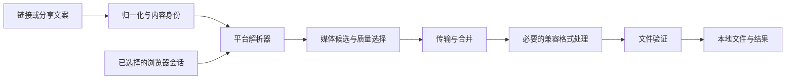

# 多平台视频下载核心需求

版本：0.1（实现与验证中的 MVP）

日期：2026-10-24（Asia/Shanghai）

后续插件阶段的交互与实现范围已单独整理为[浏览器插件首版界面与集成需求](extension-ui-requirements.md)（2026-10-25）。本文保留下载核心契约与历史阶段说明；插件采用扩展 + Native Messaging 本地组件，首版功能与验收以新文档为准。需求已确认不表示插件已经实现。

## 1. 目标与交付边界

用户提供一个 YouTube、小红书、抖音或 B站视频链接，程序自动识别目标内容，选择可用媒体，保存本地文件，并返回可信的结果或明确错误。调用方不需要了解各平台的接口、签名、音视频分离方式。

本阶段交付 **通用下载核心、Node API、CLI、平台调研和验证记录**。先验证下载方法，再设计浏览器插件右键菜单、弹窗等 UI。本地 MVP 使用 Node + yt-dlp + FFmpeg/ffprobe；浏览器引擎复用用户能够正常播放目标视频的 Ego 会话，auto 对小红书/抖音会打开浏览器。这不是已完成的浏览器插件，也不意味着四个平台的任意视频都已获支持。

### P0：本阶段

- 单链接/含一个链接的分享文案输入；平台识别、归一化、内容身份校验。
- 分离 `resolve` 与 `download`，共用元数据、错误、进度和结果模型。
- 已支持媒体路径的获取、音视频合并、本地验证和失败清理。
- yt-dlp 下载路径默认交付 MP4 + H.264（yuv420p）+ AAC；优先原生兼容流，必要时自动重封装/转码并验证实际编码。
- 支持抖音分享短链跳转至 `iesdouyin.com/share/video/<id>` 后识别目标，保留精确域名及路径校验。
- 可选质量上限、可取消任务、超时和有限重试。
- 按 engine 路由调用浏览器会话提取；不自动导出浏览器 Cookie。
- 两轮共八条用户样例分别记录已达到的验证层级和剩余问题；下载后转换与修改后重新下载分开记录。

### 后续阶段

插件 UI 与安装分发、队列与批量、断点任务持久化、播放列表/合集、直播录制、图文笔记、字幕/弹幕、精确裁切、用户可配置转码参数，以及更多样例和平台。平台已有水印或内容访问限制不属于首版的修改对象。

## 2. 四个平台：不同的解析，共用的执行

| 平台 | 内容身份与输入 | 媒体获取方式 | 需要单独处理的条件 |
| --- | --- | --- | --- |
| YouTube | 11 位 video ID；watch、短网址等 | player 响应中的分离轨道、组合流、HLS；需要随平台更新的 JS challenge 支持 | 元数据成功仍可能媒体 403；同内容已有 HLS 候选可作为另一传输路径；`t` 是播放定位 |
| 小红书 | 24 位笔记 ID；保留解析所需 `xsec_token` | 页面 `__INITIAL_STATE__` 对应笔记的 stream/master/backup URL；浏览器态可能提供更多候选 | 匿名 SSR 与浏览器可能返回不同规格；图文不应当视频；签名 URL 不持久化 |
| 抖音 | 字符串 aweme ID；分享短链、`iesdouyin.com/share/video/<id>` 与 `modal_id` 归一为 `/video/<id>` | 详情数据或目标浏览器页面的 `RENDER_DATA → app.videoDetail`，再取 bitRateList 等 | 短链每跳校验平台；匿名详情可受阻；必须对照视频 ID；同时存在合流和带 `audioFileId` 的分离流 |
| B站 | BV/av + 分 P/cid | WBI playurl、DASH 视频/音频或 durl | 新旧解析器差异明显；保留 `p`，携带必要 Referer；可用质量依赖当前响应/权限 |

机制依据与原始测试摘要见 [YouTube/B站调研](research-youtube-bilibili.md) 和 [小红书/抖音调研](research-xiaohongshu-douyin.md)。页面字段属于当前适配实现，不作为长期稳定的平台 API 承诺。

## 3. 处理流程与模块边界



- **路由层**只处理 URL、平台和身份，不把网站页面解析与下载执行揉在一起。
- **平台/引擎层**处理平台数据、会话条件和候选；第一条实现路径复用可更新的 yt-dlp，浏览器路径只读取目标页面必要数据。
- **执行层**负责传输、分段、合并、必要转码、超时取消、任务目录和文件验证。下载器可以使用 MKV 中间文件，但 yt-dlp 路径仅在最终兼容 MP4 校验成功后返回成功。
- **API/CLI 层**只接收稳定字段和脱敏结果。以后插件可复用同一契约，不复制平台签名实现。

## 4. 统一 API 契约

公开导出为 `resolveVideo(input, options)` 与 `downloadVideo(input, options)`，另提供 `resolve` / `download` 别名。CLI 使用相同核心；参数包括 `--engine`、`--max-height`、`--output`、`--transport`、`--timeout-ms`。安装与完整命令见 README。

```ts
type Platform = 'youtube' | 'xiaohongshu' | 'douyin' | 'bilibili';

type Options = {
  engine?: 'auto' | 'yt-dlp' | 'browser';
  maxHeight?: number;
  outputDir?: string;
  transport?: 'auto' | 'hls';
  signal?: AbortSignal;
  timeoutMs?: number;
  onProgress?: (event: ProgressEvent) => void;
};

resolveVideo(input: string, options?: Options): Promise<MediaInfo>;
downloadVideo(input: string, options?: Options): Promise<DownloadResult>;
```

上述是调用约定，不表示每个引擎都支持所有选项。不能支持的组合返回 `invalid_options`，不得静默忽略。`engine: auto` 对 YouTube/B站选择 yt-dlp，对小红书/抖音选择 browser；小红书只在 Ego 缺少依赖时可退到 yt-dlp，抖音不静默转回已知受阻的匿名路径。

依赖路径和显式 `cookiesFile` 属于本地高级配置。`browserSpaceId` 仅供开发测试复用已知 space；正常浏览器任务创建自己的 space，并在成功结束时 finish。不得把浏览器开发调试身份要求暴露为普通用户必填项。

### resolve 结果

| 字段 | 含义 |
| --- | --- |
| `platform`、`id` | 目标平台与字符串内容 ID；B站分 P 信息必须在内部身份保留 |
| `title`、`durationSeconds` | 可展示元数据；未知值用 null，不虚构 |
| `engine` | 实际完成解析的引擎 |
| `formats` | 规格列表：format ID、协议、容器、宽高、fps、视频/音频 codec、码率、大小、音视频轨存在情况 |
| `availability` | 此次解析是否就绪；`ready` 只表示已解析，不证明媒体可下载 |

对外的 `formats` 不暴露 Cookie、临时签名 URL 或必需鉴权请求头。媒体 URL、镜像、请求头和可能的到期信息留在内部计划中；任务执行时重新解析，不依赖调用方保存的旧媒体 URL。

### download 结果

返回 `platform`、`id`、实际 `engine`、最终绝对 `filepath`、`bytes` 和 `validation`。验证信息至少包括视频/音轨是否存在、容器时长、验证方法及 `fullDecode`。发生传输回退时，结果记录实际 `transport` 和 `fallback` 说明。yt-dlp 引擎还返回：

- `selectionPolicy: 'prefer-native-h264-aac'`，说明采用兼容编码优先策略。
- `conversion: 'copy' | 'remux' | 'transcode'`，分别表示直接使用兼容 MP4、无损重封装、至少一条轨道重新编码；`transcode` 不一定同时重编码视频和音频。
- `validation.container`、`videoCodec`、`audioCodec`、`pixelFormat`、`width`、`height`、`compatibleMp4`，均为最终文件的检测结果；静音文件的 `audioCodec` 为 null。

`resolveVideo.formats` 展示平台提供的源规格，不承诺等于最终下载选择或转码后的规格。小红书/抖音的 browser 路径不返回上述 yt-dlp 专属兼容策略字段，也不承诺把源 HEVC 等编码转为 H.264。

成功意味着本次任务已经产出有效本地文件。仅解析成功、HTTP 200、读到部分字节或外部进程退出 0，都不能单独触发成功。默认 ffprobe 结构验证须标注 `fullDecode: false`，不得表述成逐帧解码全部通过。

### 进度与生命周期

至少可区分 `resolving → downloading → validating → complete`；yt-dlp 路径在下载后增加 `postprocessing`，表示兼容性检查、重封装或转码。转码使用任务剩余时限，不另起一个完整超时预算。失败或取消通过结构化异常结束。没有可靠总字节数时展示阶段，不伪造百分比。进度回调异常不应把已完成下载改成失败。

## 5. URL、目标与会话规则

1. 只接受明确支持平台的 HTTPS 链接；拒绝凭据 URL、自定义端口、多个不明确目标和未知平台。短链最多有限跳转，每跳重新验证目标平台；需要页面 JS 展开的短链返回可操作提示。
2. 抖音长 ID 始终作为字符串，不经 JavaScript Number 转换。`jingxuan?modal_id=...` 必须取 modal_id，而不是精选页当前推荐视频。`v.douyin.com` 的 HTTP 重定向可落到 `iesdouyin.com` 或 `www.iesdouyin.com`，仅接受这两个精确主机上的 `/share/video/<id>` 路径（可带末尾斜杠），再归一为 `www.douyin.com/video/<id>`；不扩大到任意子域名或相似主机。
3. 小红书 token 保留至解析阶段；日志隐藏其值。B站追踪参数可清理，分 P `p` 必须保留。
4. YouTube `t=4538s` 结构化为 `startTimeSeconds=4538`，默认保存整片。显式裁切是独立能力，首版不因分享定位自动截断。
5. 浏览器提取必须先核对页面 URL 和数据中的内容 ID。已有页不匹配时不得保存它的媒体；页面中广告、推荐列表、预加载资源不能凭“最大文件”自动认作目标。
6. 每个候选都绑定到同一目标 ID。回退只能在这个目标的候选内进行，不能下载上一条或下一条视频充当成功。
7. 不因看到 `blob:` 就宣布可下载；必须获得对应网络媒体或可执行的分段计划。

## 6. 候选选择、下载与合并

### 质量

默认在当前访问条件和引擎策略内选择候选，`maxHeight` 是像素高度上限。yt-dlp 下载先选 H.264 + AAC，再考虑 H.264 + 其他/未知音频，最后退到其他可用源；每组内由 yt-dlp 排序，`maxHeight` 和显式 HLS 条件作用于所有回退组。因此兼容性优先可能选到低于其他编码的分辨率，不等于跨编码的最高画质。对于竖屏必须展示真实宽高；不能把 984×1920 误称作横屏“1920p”，也不能把 maxHeight 当作长边限制。

优先比较清晰度/像素规格、帧率、可用性和可处理的轨道组合。**不要跨 H.264、HEVC、AV1 仅按码率或文件大小排序**：编码效率不同，码率更低不代表画质更差。相同编码、分辨率、帧率、内容下，码率/大小可用于辅助比较。同规格 CDN 镜像应分组，不冒充多档画质。浏览器引擎首版按像素、fps 排序，同档偏好 H.264 兼容性，最后才在同 codec 内比较码率；不得将这种兼容性选择包装成客观画质排名。

若 API 不提供可靠画质或水印证据，保持未知。用户要求的质量不可得时要说明所选实际质量；不虚构“原画”或“无水印”。

### 媒体形式

- **合流单文件**：下载后检查视频与预期音频。
- **视频 + 音频**：两轨均完成后由 FFmpeg 合并。yt-dlp 路径（YouTube/B站默认，也包括其他平台显式调用或回退到该引擎）最终交付 MP4 + H.264（yuv420p）+ AAC，音轨确实不存在时保留静音。优先选择原生兼容流；不足时将可用源重封装或转码。不能仅改后缀，也不能把 VP9/AV1/Opus 放入 MP4 就宣称兼容性问题已解决。
- **兼容输出代价**：原生 H.264 的可用最高规格可能低于其他编码；实际交付规格须如实返回。必要转码保留所选源的分辨率，不主动降低尺寸，但会重新编码，可能损失画质并增加耗时/体积，不能表述为无损。仅不兼容的轨道需要重编码；结果用 `conversion` 标明 copy/remux/transcode，最终校验容器及真实编码。
- **HLS/DASH 分段**：处理清单与必要片段，任意必要片段缺失不得静默输出“完整视频”。
- **浏览器引擎首版**：小红书/抖音只接受已明确获得的合流候选，保留源 MP4 编码（可能为 HEVC），不套用 yt-dlp 的 H.264 输出承诺。抖音 `audioFileId` 等分离音轨路径留待扩展，不得把只有视频的高码率候选当作最终成片；下载后 ffprobe 必须检出音轨。

错误镜像或过期签名只做有限次候选回退/重新解析。YouTube 在下载出现 `network_error` 时自动重新解析并尝试一次 HLS，结果明确记录 `transport: 'hls'` 和 fallback；也可显式指定 `transport: 'hls'`。本策略只尝试已提供的 HLS 候选，不保证所有网络错误都能恢复。

### 文件与校验

每次任务使用独立目录，避免标题中的路径字符和重名覆盖。失败、超时或取消清理本次未完成文件，不删除用户原文件。验证至少包括非空文件、有效视频轨、预期音轨、正时长及与源时长的合理一致性；明显截断返回失败。

## 7. 浏览器补充路径与凭据最小化

当匿名解析受阻或浏览器提供更完整规格时，可使用已选择的目标浏览器页。用户只需处于能正常播放该内容的会话中；程序窄范围读取该内容数据和媒体候选，不导出全浏览器 Cookie、localStorage 或无关请求记录。

浏览器路径不得自动通过验证码或修改登录状态；若目标页面仍不可播放，返回会话/验证错误。有效登录态也不是下载成功保证。

对显式提供的 Netscape Cookie 文件，只在任务生命周期使用私有副本，避免工具写回原件，结束后删除副本。默认不读取浏览器 Cookie，不自动加载全局下载器插件/配置；调试信息只保留错误类别、阶段、引擎版本和脱敏的身份信息。

## 8. 错误模型

| 类别 | 对调用方的含义与下一步 |
| --- | --- |
| `invalid_url` / `unsupported_platform` | 输入不明确或平台未支持，要求具体视频链接 |
| `redirect_required` | 短链需要浏览器打开，使用最终详情页 |
| `invalid_options` / `dependency_missing` | 参数组合或本地环境不足，指出需要修正的配置 |
| `auth_required` / `verification_required` / `session_required` | 当前会话没有访问条件，使用可播放目标的浏览器会话后重试 |
| `unavailable` | 仅在有证据时表示删除、地区限制、未完成直播等；不能从所有 403 推断 |
| `browser_state_missing` / `browser_unavailable` | 目标页面数据或浏览器连接尚不可用；浏览器错误可返回供接管的空间编号 |
| `identity_mismatch` / `invalid_media_url` | 数据身份或媒体域不匹配，拒绝下载 |
| `media_expired` / `size_limit` | 媒体签名失效或超过浏览器引擎的体积限制 |
| `no_formats` | 该内容没有符合能力和质量条件的视频候选 |
| `drm` | 不进入本方法的解密范围 |
| `network_error` / `timeout` | 传输或时限失败；有界重试，不无限循环 |
| `conversion_failed` / `output_exists` | 无法完成兼容MP4转换，或输出已存在；不得覆盖用户原文件或伪报成功 |
| `output_invalid` | 文件为空、缺轨、时长明显不足或无法识别，不返回成功 |
| `cancelled` | 用户取消；结束本地子进程并清理本任务未完成文件；浏览器端已触发的操作不保证撤销 |
| `engine_error` | 仍未分类的解析/执行失败；建议检查版本，不能泄漏原始凭据日志 |

错误分类是恢复指引，不是未经验证的根因结论。例如 yt-dlp 的 fresh cookies 提示，不足以证明“必须登录”；媒体 403 也不足以证明具体 PO Token 故障。

## 9. 验收矩阵

下表保留最初一轮调研的**历史证据**（当时采用MKV输出）；当前兼容MP4策略的验证另行记录。初轮文件规格和命令见 [实测记录](validation.md)。禁止因为一条样例通过就把整个平台标成无条件支持。

| 样例 | 身份/解析 | 部分媒体读取 | 完整文件/合并验证 | 结论边界 |
| --- | --- | --- | --- | --- |
| YouTube `EWvNQjAaOHw` | 新版成功，7872 秒 | HTTPS 默认候选 403；HLS 分片成功 | 统一CLI完整HLS两轨合并，640×360、VP9/AAC、7871.797秒，ffprobe通过 | 更高清、其他会话与全片逐帧解码未验收 |
| 小红书 `6adb92b90000000031037a66` | 匿名 SSR 为 720×1404；目标浏览器还观察到 EF5 984×1920 | 匿名候选 64 KiB HTTP 206；浏览器保留记录亦有媒体 206 | 已整片保存720×1404，146.7秒，H.264/AAC；另行完整解码通过 | 高规格尚未验收；浏览器规格多于 SSR 只证明当前样例；不保证所有笔记 |
| 抖音 `7695202760953793827` | 统一视频ID；yt-dlp使用/video入口仍受阻；浏览器使用jingxuan modal入口的app.videoDetail，ID匹配 | 合流完整传输成功 | 已整片保存576×1024，2082.066667秒，H.264/AAC；另行完整解码通过 | 浏览器首版仅合流，必须检音轨 |
| B站 `BV19Pnb6REhD` | 旧版 412；2026.10.21 匿名成功，1361.109 秒 | 视频/音频各 64 KiB，HTTP 206 | 统一CLI整片合并640×360，1361.109秒，AV1/AAC；另行完整解码通过 | 更高清与会员规格未测 |

浏览器调研补充：脱敏 HAR 中的小红书媒体记录为 HTTP 206，`Content-Range: bytes 0-262143/10167052`。REA 对历史记录的 Evidence ID 为 `ev_4b2baa75bffc7197dea046e35197eab7b628e4f2ad02e04ebf82490bcd60e174`。这确认保留记录的内容；REA 本身没有据此证明请求来自哪个真实运行时，不把离线分析写成实时抓包归因。

### 必须覆盖的测试

- 四条原始输入准确归一；B站分 P、抖音字符串长 ID、小红书访问参数和 YouTube 时间戳不丢失。
- 抖音短链经过 `iesdouyin.com/share/video/<id>` 正确归一到同一目标；直接分享页、两个精确域名及末尾斜杠均可处理，相似域名和错误分享路径拒绝。
- 不支持主机、多链接、跨平台短链、重定向循环和身份不匹配拒绝执行。
- 独立音视频最终含两轨；图文/无视频拒绝；浏览器路径无音轨不能成功。
- yt-dlp 输出的扩展名、实际容器、H.264/yuv420p/AAC、宽高和时长均须验证；覆盖兼容 MP4 直接使用、MKV 无损重封装、VP9/AV1/非 AAC 转码、静音视频和仅音频需转码的情况。
- 兼容选择在所有回退组遵守高度/HLS限制；转码超时或取消不能留下伪成片，已有输出和用户原文件不得被覆盖或误删。
- 同一内容不同编码的质量选择不凭码率大小直接比较；镜像数量不当清晰度数量。
- HTTP 失败、过期媒体、超时、取消、缺依赖、空输出与不完整文件均有可区分错误，未完成文件清理。
- API 输出、CLI JSON、进度和错误均不含 Cookie、token 值或完整签名媒体 URL。
- CLI 与 API 对同一输入采用同一处理核心，不产生两套平台逻辑。

截至本次修订，60 项自动测试通过；使用真实 FFmpeg/ffprobe 验证生成的小样本，无平台网络请求。第二轮四条新链接均完成整片下载；YouTube `eA9Zf2-qYYM` 和 B站 `BV1TeJ96EE5t` 随后由已下载 MKV 转为 1080p H.264/AAC MP4，小红书与抖音保留源 MP4。修改后的格式选择另以真实解析结果检查，尚未对这两条链接重新执行完整下载。具体大小、时长、命令和验证范围见 [实测记录](validation.md)。

## 10. 后续插件方式的取舍

| 方案 | 合适场景 | 额外工作 |
| --- | --- | --- |
| 纯浏览器扩展 | 可直接获取合流文件的轻量保存 | 音视频分离、长视频分段合并、内存/生命周期、下载头和权限都要重新验证；不能假设直接照搬本地 Node/FFmpeg |
| 扩展 + Native Messaging 本地程序 | 复用本次下载核心和本地 FFmpeg，覆盖分离轨道与长视频 | 需要本地程序安装、各系统 host 注册、扩展来源约束、更新和错误反馈 |

Chrome downloads API 提供下载发起与状态管理，需要 downloads 权限；它不构成本项目的媒体解析与 FFmpeg 合并实现。[Chrome downloads 文档](https://developer.chrome.com/docs/extensions/reference/api/downloads)

Native Messaging 由扩展通过标准输入输出与注册的本地 host 通信；这可以承接本次 Node 核心，但打包、host 配置和平台兼容仍是后续工作。[Chrome Native Messaging 文档](https://developer.chrome.com/docs/extensions/develop/concepts/native-messaging)

建议先根据真实样例证明核心可用，再决定是否接受本地组件安装成本；本轮不提前设计 UI，也不把临时 Ego 调研脚本当成可分发扩展。

## 11. 阶段完成标准

1. **调研**：四个平台的目标身份、媒体形式、会话条件与未知项有证据记录。本次已形成，范围如上。
2. **本地核心 MVP**：统一 API/CLI 可运行；相关单元/故障测试通过；每条样例如实标注解析、传输、整片验证状态。未通过项有可复现错误，不隐藏为“已支持”。
3. **稳定性补齐**：更多公开视频、短链、分 P、不同编码、会话失效和平台更新回归；再决定浏览器路径和自动回退的正式支持范围。
4. **插件阶段**：选择纯扩展或 Native Messaging，完成页面目标选择、右键触发、进度、错误恢复和安装测试。UI 只调用已验证的下载契约。
